# Distributed Book Pricing Analytics Pipeline

[](.github/workflows/ci.yml)

A **PySpark batch pipeline** for used-book pricing analytics. It ingests real book metadata
from the public **Open Library REST API**, lands it as immutable raw JSON, and runs
**bronze → silver → gold** Spark transformations: ISBN normalization with checksum
validation, deduplication with window functions, rejected-record routing and a data-quality
gate. The outputs are **partitioned Parquet** datasets, loaded idempotently into
**PostgreSQL**.

The domain comes from my own used-book resale work (BooksAreReborn / TechBaR). **All
prices and inventory in this project are simulated** (see
[Data sources and limitations](#data-sources-and-limitations)).

```bash
make demo   # Docker only: PostgreSQL + Spark pipeline + console report
```

---

## Contents

1. [Why PySpark](#why-pyspark)
2. [Architecture](#architecture)
3. [Data flow](#data-flow)
4. [Quick start](#quick-start)
5. [Commands and expected output](#commands-and-expected-output)
6. [Data-quality rules](#data-quality-rules)
7. [Pricing rule](#pricing-rule)
8. [Partitioning and incremental processing](#partitioning-and-incremental-processing)
9. [PostgreSQL schema](#postgresql-schema)
10. [Tests and CI](#tests-and-ci)
11. [Data sources and limitations](#data-sources-and-limitations)
12. [Skills demonstrated](#skills-demonstrated)

---

## Why PySpark

The local dataset is small: a few hundred listings per day. A pandas script would handle
it. Spark is here because the project mirrors how this workload looks in production, where
daily marketplace feeds hold millions of listings across many sellers:

- **The same code scales out.** Every transformation is a Spark DataFrame expression, with
  no Python UDFs: ISBN checksums are native Catalyst expressions. The driver only sees
  small things: per-rule quality counts, and the ISBN → metadata dimension that is
  broadcast for the join. The PostgreSQL loader streams rows partition by partition with
  `toLocalIterator`.
- **The job is cluster-ready.** It runs in `local[*]` mode here: one JVM, one executor
  thread per CPU core. The job never hard-codes a master, so
  `spark-submit --master yarn|k8s://…` runs it unchanged.
- **The patterns are the point:** explicit schemas, `PERMISSIVE` corrupt-record capture,
  `Window` + `row_number` dedup, broadcast joins, partition pruning, partition-scoped
  overwrite.

**Local-mode honesty:** there is no Spark master/worker cluster in Docker Compose. On one
laptop it would add moving parts and no real parallelism. Datasets are intentionally small;
this project does not claim big-data scale.

## Architecture

```mermaid
flowchart LR
    OL[(Open Library<br/>Search API)] -->|requests + retries| ING[fetch_books.py]
    ING --> RAW["raw/open_library/<br/>ingestion_date=…/subject=…<br/>*.response.json + *.meta.json<br/>(immutable)"]
    RAW --> GEN[generate_observations.py<br/>seeded, SIMULATED]
    GEN --> RAWOBS["raw/demo_observations/<br/>processing_date=…/observations.jsonl"]

    subgraph SPARK [PySpark job · spark-submit · local mode]
        direction TB
        B[Bronze<br/>explicit schemas<br/>corrupt-record capture<br/>lineage columns]
        S[Silver<br/>ISBN normalize + checksum<br/>exact + window dedup<br/>validation + rejects<br/>broadcast metadata join]
        G[Gold<br/>pricing recommendations<br/>category summary<br/>quality report + gate]
        B --> S --> G
    end

    RAW --> B
    RAWOBS --> B
    G --> PQ[("Partitioned Parquet<br/>bronze / silver / gold")]
    PQ --> LOAD[postgres_loader.py<br/>COPY → staging →<br/>DELETE + INSERT<br/>one transaction]
    LOAD --> PG[(PostgreSQL<br/>analytics schema)]
```



## Data flow

| Step | Code | Reads | Writes |
|---|---|---|---|
| 1. Ingest | [`src/ingestion/fetch_books.py`](src/ingestion/fetch_books.py) | Open Library `/search.json?subject=…` | `raw/open_library/ingestion_date=D/subject=S/<run_id>.response.json` (untouched bytes) + `.meta.json` (URL, params, status, timing, record count, SHA-256) |
| 2. Simulate | [`src/generators/generate_observations.py`](src/generators/generate_observations.py) | latest landed response per subject with `ingestion_date ≤ D` | `raw/demo_observations/processing_date=D/observations.jsonl` + `_manifest.json` (expected defect counts) |
| 3. Bronze | [`src/transforms/bronze.py`](src/transforms/bronze.py) | raw JSON / JSONL | `bronze/observations`, `bronze/book_isbns` |
| 4. Silver | [`src/transforms/silver.py`](src/transforms/silver.py), [`isbn_columns.py`](src/transforms/isbn_columns.py) | bronze | `silver/observations`, `silver/rejected_observations`, `silver/book_metadata` |
| 5. Gold | [`src/transforms/gold.py`](src/transforms/gold.py), [`quality.py`](src/transforms/quality.py) | silver | `gold/daily_pricing_recommendations` (by category), `gold/category_pricing_summary`, `gold/data_quality_report` |
| 6. Load | [`src/loaders/postgres_loader.py`](src/loaders/postgres_loader.py) | gold + rejected | `analytics.*` tables |

Silver, step by step:

1. **Standardize.** ISBNs lose hyphens and spaces; ISBN-10s are checksum-validated and
   converted to ISBN-13. Titles and authors get whitespace collapsed. Categories become
   `lower_snake_case`. Conditions are upper-cased and aliased (`very good`, `Very-Good`,
   `VG` → `VERY_GOOD`).
2. **Exact duplicates** (identical content) are dropped with `dropDuplicates`.
3. **Validation.** Every rule is evaluated per row. Failing rows go to
   `rejected_observations` with **all** failing reasons (`text[]`), not just the first.
4. **Business duplicates** are resolved after validation:
   `Window.partitionBy(isbn_13, condition, source).orderBy(observed_at desc)` +
   `row_number() == 1` keeps the newest listing. Deduping after validation means an
   invalid newer row can never hide a valid older one.
5. **Enrichment.** A broadcast left join to `book_metadata` adds the Open Library work key
   and first-publish year, plus quality flags (`no_metadata_match`,
   `listing_far_above_market`). Flags are warnings, not rejections.

## Quick start

### Option A: Docker only (recommended for reviewers)

Requires Docker with Compose v2. No local Python or Java needed.

```bash
git clone https://github.com/omerbar4/distributed-book-pricing-analytics.git
cd distributed-book-pricing-analytics
make demo
```

`make demo` starts PostgreSQL 16 (bound to `127.0.0.1:55432`), builds the pipeline image
(Python 3.12, Java 17, PySpark 4.0.4), and runs [`scripts/run_demo.sh`](scripts/run_demo.sh):
ingest → simulate → `spark-submit` → load → report. Outputs land in `./data`.

Without `make`, use `docker compose run --rm --build pipeline`.

Useful knobs (environment variables):

```bash
SUBJECTS="fantasy history" INGEST_LIMIT=20 make demo   # fewer API calls
DATE=2026-10-21 make demo                              # process another date
SKIP_INGEST=1 make demo                                # offline re-run on landed raw data
make psql                                              # then: \i sql/example_queries.sql
make down        # stop (keeps data)        make reset-db   # also delete the DB volume
```

### Option B: local development

Requires Python 3.11/3.12 and Java 17 or 21 (`JAVA_HOME`; the Makefile falls back to
Homebrew `openjdk@21`). Docker is still used for PostgreSQL.

```bash
make setup        # .venv + pip install -e ".[dev]"  (versions live only in pyproject.toml)
make up           # PostgreSQL in Docker
make test         # unit + Spark + PostgreSQL integration tests
make demo-local   # same demo script, using the host's .venv and JVM
```

Individual stages: `make ingest | generate | pipeline | load | report` (each takes `DATE=`).
To call `spark-submit` directly, first `source .venv/bin/activate` (or set
`PYSPARK_PYTHON`), so the wrapper finds the venv's PySpark:

```bash
spark-submit src/jobs/book_pricing_pipeline.py --processing-date 2026-10-20
```

Configuration is read from environment variables; see [`.env.example`](.env.example).

## Commands and expected output

```text
python -m src.ingestion.fetch_books --subject science_fiction --limit 40 --ingestion-date 2026-10-20
→ {"ingestion_date": "2026-10-20", "succeeded": ["science_fiction"], "failed": []}

python -m src.generators.generate_observations --processing-date 2026-10-20
→ {"book_count": …, "clean_observation_count": …, "injected_defects": {"negative_price": 2, …}, …}

spark-submit src/jobs/book_pricing_pipeline.py --processing-date 2026-10-20
→ {"input_record_count": …, "valid_record_count": …, "rejected_record_count": 10,
   "exact_duplicate_count": 2, "business_duplicate_count": 2, "quality_gate_passed": true, …}
```

Exit codes: `0` success · `1` error · `2` quality gate failed. The job still writes its
outputs on a failed gate so they can be inspected, but the loader refuses to publish them.

### Verified run

<!-- VERIFIED_RUN_START -->
Recorded on 2026-10-20 from a **fresh `git clone`** with an empty database, on an Apple
Silicon Mac with Docker Desktop. To keep live API traffic minimal, it used one subject
(`SUBJECTS=science_fiction INGEST_LIMIT=40 make demo DATE=2026-10-20`); the default demo
fetches five.

| Measure | Result |
|---|---|
| Image build (`--no-cache`, base images already pulled) | 40 s |
| Full demo: ingest → generate → Spark → load → report | 20 s, exit 0 |
| Open Library works landed (1 request) | 40, all with ISBNs (7,280 ISBN values; 112,523-byte body, SHA-256 verified) |
| Distinct valid ISBN-13s in `silver/book_metadata` | 3,963 |
| Observation lines in / valid / rejected | 90 / 76 / 10 |
| Exact / business duplicates | 2 / 2 |
| Rejections by rule | invalid ISBN 2, negative price 2, blank title 2, invalid inventory 2, malformed 2 |
| Quality pass rate / gate | 0.8864 / passed |
| Rows matching the generator manifest | all counts identical |
| `analytics.daily_pricing_recommendations` rows | 76 (all `SIMULATED_DEMO`) |
| Re-run of the same date (`SKIP_INGEST=1`) | 76 deleted, 76 inserted, row counts unchanged |

Counts depend on Open Library's live index and will differ on your run.
<!-- VERIFIED_RUN_END -->

## Data-quality rules

| Rule | Rejects when | Demo defect that triggers it |
|---|---|---|
| `malformed_record` | line is not valid JSON for the schema (Spark `PERMISSIVE` → `_corrupt_record`) | truncated JSON line |
| `invalid_isbn` | not a 10/13-digit ISBN, or checksum fails | wrong check digit; `"12345"` |
| `blank_title` | title null or whitespace | `"   "`, `null` |
| `negative_price` | listing or market price < 0 | negated listing price |
| `invalid_inventory` | null, < 0, or > 10,000 | `-4`, `1000000` |
| `missing_price` · `missing_category` · `invalid_condition` · `invalid_observed_at` · `missing_observation_id` | as named | (covered by unit tests) |

Duplicates are counted, not rejected: **exact** (identical rows) and **business** (same
ISBN + condition + source, older `observed_at`).

**Row accounting is enforced.** The job raises an error unless
`input = exact_duplicates + rejected + business_duplicates + valid`.
`quality_pass_rate = rows passing validation / rows evaluated`. If it falls below
`--min-pass-rate` (default 0.80), the run exits with code 2 and the loader will not
publish that date.

The generator writes the injected defect counts to `_manifest.json`, and a test asserts
that the Spark quality report matches them exactly.

## Pricing rule

Deliberately simple and explainable ([`gold.py`](src/transforms/gold.py)):

| Inventory | Recommended price | Reason code |
|---|---|---|
| ≥ 10 | market × 0.95 | `HIGH_INVENTORY_5PCT_BELOW_MARKET` |
| ≤ 2 | market × 1.05 | `LOW_INVENTORY_5PCT_ABOVE_MARKET` |
| otherwise | market | `AT_MARKET` |

Prices never go below a **$1.00 floor** (`+PRICE_FLOOR` is appended to the reason) and are
rounded to cents. `price_change = recommended − current listing`.

## Partitioning and incremental processing

```
data/
  raw/open_library/ingestion_date=2026-10-20/subject=fantasy/<run_id>.response.json
  raw/demo_observations/processing_date=2026-10-20/observations.jsonl
  bronze/{observations,book_isbns}/processing_date=2026-10-20/
  silver/{observations,rejected_observations,book_metadata}/processing_date=2026-10-20/
  gold/daily_pricing_recommendations/processing_date=2026-10-20/category=fantasy/part-….parquet
  gold/{category_pricing_summary,data_quality_report}/processing_date=2026-10-20/
```

- **Unit of work = one processing date.** A run reads only that date's observations, plus
  Open Library metadata landed on or before the date. Both reads are pruned by partition
  filters.
- **Idempotent overwrite.** Each dataset write replaces exactly
  `<dataset>/processing_date=D/`. Re-running D gives the same result (tested). Other dates
  are never touched (tested), so backfills can run in any order.
- **Raw is append-only.** Ingestion opens files in exclusive-create mode, so a re-run adds
  a new `run_id` and never overwrites. Silver keeps the newest run per ISBN with a window
  function.
- **Partitioning is restrained on purpose.** Only the gold recommendations add a second
  level (`category`, a natural filter for consumers). Each partition is written as one file
  because local data is tiny. On a cluster, file counts would be sized from volume.

## PostgreSQL schema

DDL: [`sql/001_init.sql`](sql/001_init.sql). Example queries:
[`sql/example_queries.sql`](sql/example_queries.sql) (highest/lowest recommendations,
category summary, repricing impact, quality trend, recent failures by rule).

| Table | Primary key | Contents |
|---|---|---|
| `analytics.daily_pricing_recommendations` | `(processing_date, isbn_13, condition)` | listing, market, recommended price, reason, `data_origin = 'SIMULATED_DEMO'` |
| `analytics.category_pricing_summary` | `(processing_date, category)` | valid books, avg/median listing, avg recommended, inventory, invalid count |
| `analytics.data_quality_report` | `processing_date` | all counts above, pass rate, gate result |
| `analytics.rejected_records` | surrogate `bigserial` | raw values + `rejection_reasons text[]` |

**Loading is idempotent and atomic.** For each table, rows stream from Parquet
(`toLocalIterator`) into a temp staging table via `COPY`. Then `DELETE … WHERE
processing_date = %s` and `INSERT … SELECT` from staging. All four tables run in **one
transaction** under an advisory lock, and SQL is parameterized (`psycopg.sql` identifiers,
`%s` values). Spark's JDBC writer was not used because it cannot atomically replace a
single date's rows.

## Tests and CI

```bash
make test    # or: pytest -q   (integration tests skip if PostgreSQL is down; run `make up`)
make lint    # ruff check + ruff format --check
```

| Test file | Covers |
|---|---|
| `test_isbn.py` | ISBN-10/13 validation and conversion; **Spark expressions vs Python reference on 1,200+ inputs** |
| `test_ingestion.py` | real local HTTP server: retries on 429/503, give-up, no retry on 404, timeouts, bad JSON, byte-exact landing, no-overwrite, unsafe subject names |
| `test_generator.py` | determinism by seed, labeling, injected defect counts |
| `test_silver.py` | standardization, exact + window dedup, invalid-newer-doesn't-shadow-valid-older, every rejection rule, metadata join |
| `test_gold_quality.py` | pricing rule boundaries + floor + rounding, median, full-outer category join, metric math, gate, accounting check |
| `test_pipeline.py` | whole job on synthetic raw data: quality report == generator manifest, partition layout, idempotent re-run, other dates untouched |
| `test_postgres_loader.py` | load == Parquet, re-load doesn't duplicate, values replaced, `text[]`/`timestamptz` round-trip, failed gate blocks publishing |

Tests use a shared session-scoped `local[2]` SparkSession and synthetic fixtures (clearly
labeled). There is no network access and no randomness without a seed.

**GitHub Actions** ([`ci.yml`](.github/workflows/ci.yml)), on every push and pull request:

1. lint and run the full test suite on Python 3.12 + Temurin Java 17, with a PostgreSQL 16
   service container. `REQUIRE_POSTGRES=1` makes integration tests fail instead of skip;
2. validate the Compose file and build the Docker image.

No secrets or external services are needed, and the expensive live demo is not run in CI.

## Data sources and limitations

- **Book metadata is real.** It comes from the [Open Library Search
  API](https://openlibrary.org/dev/docs/api/search) (titles, authors, ISBNs, first-publish
  year), fetched politely: identifying User-Agent, a pause between subjects, retries that
  honor `Retry-After`. Results depend on Open Library's live index, so counts vary between
  runs.
- **Prices and inventory are simulated.** Open Library does not publish used-book prices,
  and this project has no marketplace data partnership. The generator derives prices from a
  fixed per-category base, a condition multiplier and seeded noise. Every record says
  `source = demo_simulated_feed_v1`, and every database row says
  `data_origin = 'SIMULATED_DEMO'`. **None of it is market data, and no business results
  are claimed.**
- **Defects are injected on purpose.** Exactly `defects_per_type` (default 2) of each kind,
  so the data-quality layer has something real to catch.
- **Scale is small.** It runs in Spark local mode on one machine, with a few hundred rows
  per day. The design patterns are the deliverable, not the volume.
- Subject search is keyword-based, so a work can match several subjects. The generator
  lists each ISBN once (first subject alphabetically wins).
- PostgreSQL credentials in `.env.example` and CI are throwaway local values.

## Skills demonstrated

| Skill | Where |
|---|---|
| **PySpark / Spark** | DataFrame API throughout; explicit `StructType` schemas; `PERMISSIVE` + `_corrupt_record`; `withColumn`/`when`/`regexp_replace`/`trim`/`lower`; `dropDuplicates`; `Window.partitionBy` + `row_number`; broadcast + full-outer joins; `groupBy().agg()` incl. `median`, `countDistinct`; `explode`; higher-order `array_compact`; native-expression ISBN checksums (ANSI-safe, no UDFs); partitioned Parquet; partition pruning; `spark-submit` entry point |
| **Python** | typed, modular package; `argparse` CLIs with exit codes; dataclasses; structured JSON logging; deterministic seeded generation; env-based config |
| **SQL / PostgreSQL** | DDL with keys, CHECK constraints, indexes, `text[]`; transactional delete+insert via `COPY` staging; advisory locks; parameterized `psycopg.sql`; analytic queries (`FILTER`, `unnest`, subqueries) |
| **REST APIs** | `requests` session, timeouts, `urllib3.Retry` with backoff on 429/5xx and `Retry-After`; payload validation; immutable raw landing with SHA-256 metadata |
| **Data quality** | rule catalog with multi-reason rejects, rejected-records dataset/table, exact vs business duplicate accounting, enforced row accounting, pass-rate gate that blocks publishing, ground-truth reconciliation test |
| **Docker** | slim non-root pipeline image with JRE; Compose with healthchecks, localhost-only port, init SQL, one-command demo |
| **Automated testing** | 80+ pytest tests: unit, Spark, real-HTTP-server ingestion, whole-job and PostgreSQL integration |
| **CI/CD** | GitHub Actions: lint, tests with a Postgres service container, Docker build; no secrets |

### Resume bullet

> _Use only once you have run the project yourself and are comfortable explaining it:_
>
> Built a PySpark batch pipeline that normalized and deduplicated book-market records,
> wrote partitioned Parquet datasets, and loaded daily pricing recommendations into
> PostgreSQL with automated data-quality checks.

## License

MIT, see [LICENSE](LICENSE).
